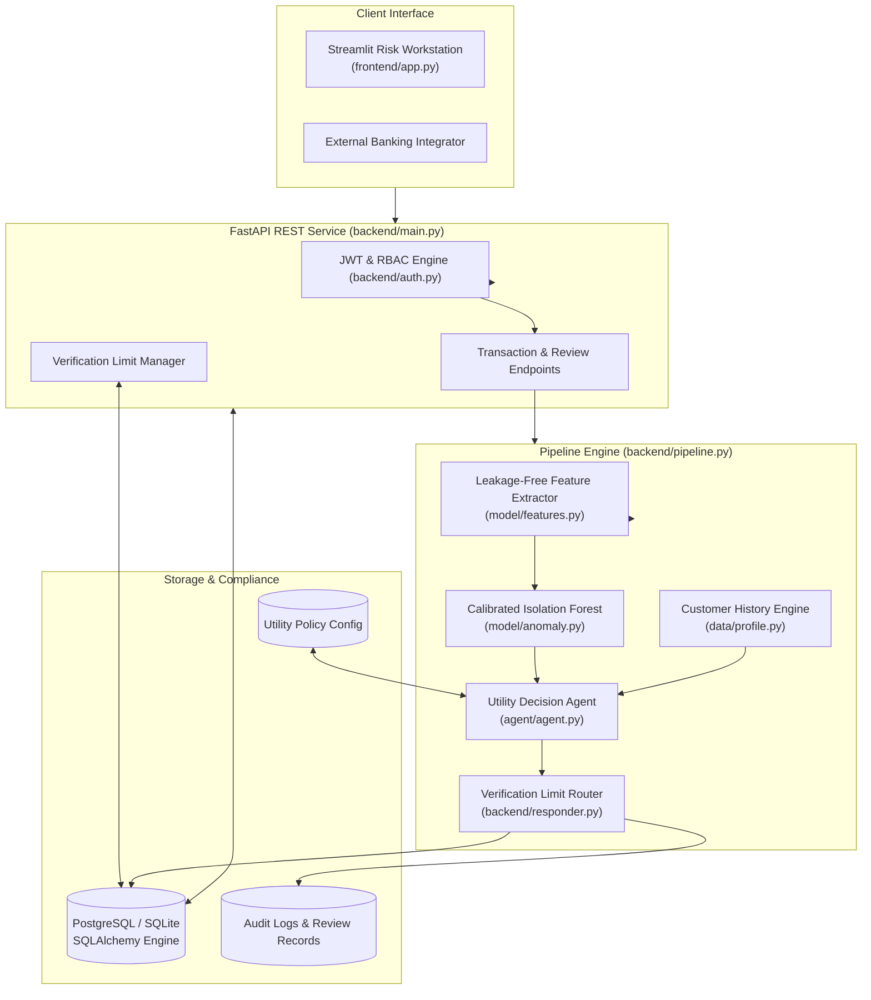

# System Architecture and Data Flow

## 1. System Overview

The **AI Transaction Monitor** is designed as a modular, research-grade financial risk platform that couples machine learning anomaly detection with an autonomous utility agent and configurable human-in-the-loop oversight.

## 2. Microservice Layer & REST Contracts

The FastAPI backend enforces a clean microservice architecture:
- All communications from the Streamlit frontend pass through REST API endpoints over HTTP/JSON using Bearer JWT authentication tokens.
- **Zero direct database calls from the frontend:** Guaranteed through architectural unit tests (`test_dashboard_uses_api_not_database_directly`).

### Role-Based Access Control (RBAC) Matrix
| Resource / Operation | Unauthenticated | Analyst | Reviewer | Admin |
| :--- | :---: | :---: | :---: | :---: |
| Health Check & Demo View | Yes | Yes | Yes | Yes |
| Transaction History Search | No | Yes | Yes | Yes |
| Customer Profile Exploration | No | Yes | Yes | Yes |
| Single Transaction Scoring | No | Yes | Yes | Yes |
| Human Review Decision Execution | No | No | **Yes** | **Yes** |
| Mandatory Verification Limit Edit | No | No | No | **Yes** |
| System Audit Trail Inspection | No | Yes | Yes | Yes |

## 3. Storage Architecture

The application uses **SQLAlchemy 2.0** ORM to seamlessly bind to PostgreSQL in production environments with an automatic, resilient SQLite fallback for local developer workstations:

- `DATABASE_URL` controls the active connection pool.
- Relational tables: `organizations`, `memberships`, `users`, `customers`, `transactions`, `fraud_predictions`, `ai_decisions`, `human_reviews`, `audit_logs`, `app_settings`, and `feedback`.
- Foreign key cascading deletes and composite B-tree indexes on `(org_id, customer_id, step)` and `(org_id, entity_type, entity_id)` ensure sub-millisecond query performance and strict tenant partitioning.

## 4. Strict Multi-Tenant Isolation Architecture

The platform provides cryptographic and database-level tenant isolation across organizations:

1. **Context Derivation Without Trusting Client Claims:**
   - The user's active tenant context is extracted from their verified JWT token or validated against the `memberships` table when specified via `X-Org-ID`.
   - Client requests with forged or unauthorized `X-Org-ID` values are immediately rejected with HTTP 403 Forbidden.

2. **Database-Enforced Composite Constraints:**
   - The `customers` table utilizes a composite primary key `(customer_id, org_id)`.
   - The `transactions` table enforces a composite foreign key constraint:
     `FOREIGN KEY (customer_id, org_id) REFERENCES customers (customer_id, org_id) ON DELETE CASCADE`.
   - Cross-tenant referencing is mathematically impossible at the database engine level.

3. **Tenant-Scoped Operational Pipelines:**
   - Transaction ingestion, scoring, anomaly features, customer profiling, human review queues, audit logs, and verification limits are strictly scoped to the active tenant's `org_id`.
   - Organization A and Organization B can hold identical numerical `customer_id` values (e.g., `#777`) with entirely disjoint financial histories, transaction volumes, risk indicators, and review queues.

