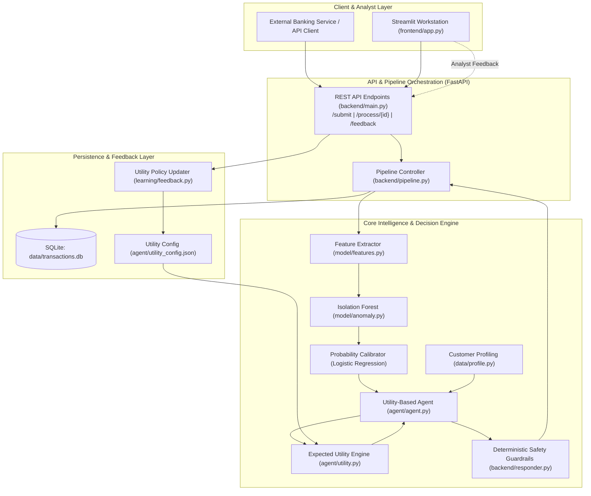

# AI Transaction Monitor: End-to-End Technical Documentation & Project Brief

---

## 1. Executive Summary & Abstract

* **Project Title:** AI Transaction Monitor (Intelligent Fraud Detection, Autonomous Utility Agent & Guardrail System)
* **Problem Domain:** Financial Transaction Monitoring & Fraud Prevention
* **Core Problem:** Traditional fraud detection uses rigid supervised machine learning models with fixed binary decision thresholds (e.g., $P(\text{fraud}) > 0.5 \implies \text{Block}$). In financial institutions, this leads to:
  1. **Extreme Asymmetric Costs:** Blocking a high-value legitimate customer causes reputational damage, transaction friction, and customer churn. Conversely, missing a large fraud drains funds.
  2. **Lack of Nuance:** Traditional systems force a binary Approve/Block decision. Real-world operations require intermediate steps such as **Hold** (temporary verification pause) or **Escalate** (human compliance review).
  3. **Black-Box Autonomy Risks:** Autonomous AI taking blocking actions without confidence checks or high-value caps creates compliance and legal vulnerabilities.
* **Proposed Solution:** A hybrid, human-in-the-loop autonomous system combining:
  * **Unsupervised Anomaly Detection:** Isolation Forest identifying structurally anomalous transaction behaviors without relying purely on historic fraud labels.
  * **Probability Calibration:** Logistic Regression calibrating raw tree-isolation scores into true probabilities: $P(\text{fraud}) \in [0.0, 1.0]$.
  * **Utility-Based Rational Agent:** An AI agent leveraging **Expected Utility Theory** and historical customer profiles to select the mathematically optimal action among `approve`, `hold`, `escalate`, and `block`.
  * **Deterministic AI Safety Guardrails:** Hard rules that prevent low-confidence blocks or high-value autonomous freezes without human oversight.
  * **Active Learning via Utility Adaptation:** Analyst review feedback dynamically adjusts utility payoff matrices without requiring expensive and destabilizing ML model retraining.
  * **Microservice Architecture:** FastAPI REST backend serving a multi-tab Streamlit fraud analyst workstation.

---

## 2. High-Level System Architecture

---

## 3. End-to-End Transaction Lifecycle

1. **Ingestion:** A transaction arrives via `POST /submit` with parameters: `customer_id`, `type` (`TRANSFER`, `CASH_OUT`, `PAYMENT`), `amount`, `old_balance`, `new_balance`.
2. **Feature Extraction:** 
   * `amount_ratio` = $\frac{\text{amount}}{\text{old\_balance} + 1}$
   * `drained` = $1$ if ($\text{new\_balance} == 0 \land \text{old\_balance} > 0$) else $0$
   * One-hot encodings: `type_TRANSFER`, `type_CASH_OUT`, `type_PAYMENT`.
3. **Anomaly Scoring & Calibration:**
   * Isolation Forest evaluates sample depth: $\text{raw} = -\text{score\_samples}(X)$.
   * Scaled to $[0, 1]$ anomaly score: $\text{score} = \text{clip}\left(\frac{\text{raw} - \text{lo}}{\text{hi} - \text{lo}}, 0, 1\right)$.
   * Logistic Regression Calibrator maps vector `[score, drained, amount_ratio, type_TRANSFER, type_CASH_OUT]` into calibrated probability $P(\text{fraud}) \in [0, 1]$.
4. **Context-Aware Profiling:**
   * Customer history is retrieved from SQLite: `average_amount`, `num_transactions`, and `past_flags`.
   * Temporal gating ensures transactions at or after the current simulation step are excluded (preventing lookahead leakage).
5. **Probability Adjustment:**
   * The Agent adjusts $P(\text{fraud})$ based on deviations from normal customer behavior:
     * If $\text{num\_transactions} \ge 5$ and $\text{amount} > 10 \times \text{average}$: $+0.15$
     * Else if $\text{amount} > 5 \times \text{average}$: $+0.07$
     * If $\text{past\_flags} \ge 2$: $+0.05$
     * Result is bounded in $[0.0, 1.0]$.
6. **Expected Utility Maximization:**
   * The agent calculates $\mathbb{E}[U(a)]$ for all $a \in \{\text{approve}, \text{hold}, \text{escalate}, \text{block}\}$.
   * The action maximizing expected utility is selected: $a^* = \arg\max \mathbb{E}[U(a)]$.
   * Confidence is computed from the margin between the best and second-best action utilities.
7. **Guardrail Intervention:**
   * `backend/responder.py` inspects the candidate decision.
   * If `block` is chosen with $\text{confidence} < 0.70 \implies$ demoted to `escalate` (decided by `guardrail`).
   * If `block` is chosen with $\text{amount} > \$5,000,000 \implies$ demoted to `escalate` (decided by `guardrail`).
8. **Persistence & Alerting:**
   * Transaction status updated (`approve`, `hold`, `escalate`, `block`).
   * Complete rationale and metadata written to `actions_log`.
   * If flagged (`!= approve`), alert is triggered.
9. **Human Review & Active Learning:**
   * Escalated transactions appear in the Streamlit Review Queue.
   * Analyst resolves case (`approve` or `block`).
   * Stored in `feedback` table; updates utility weights via `learning/feedback.py`.

---

## 4. Mathematical Foundations

### 4.1 Expected Utility Formulation
Let $A = \{\text{approve}, \text{hold}, \text{escalate}, \text{block}\}$ be the set of possible actions.  
Let $S = \{\text{fraud}, \text{legit}\}$ be the true state of the transaction.  
Let $p = P(\text{fraud}) \in [0, 1]$ be the agent's adjusted probability of fraud.  
The probability of a legitimate transaction is $P(\text{legit}) = 1 - p$.

For each action $a \in A$, the Expected Utility $\mathbb{E}[U(a)]$ is defined as:
$$\mathbb{E}[U(a)] = p \cdot U(a, \text{fraud}) + (1 - p) \cdot U(a, \text{legit})$$

### 4.2 Default Utility Payoff Matrix
| Action ($a$) | Utility if Fraud ($U(a, \text{fraud})$) | Utility if Legit ($U(a, \text{legit})$) | Financial & Operational Rationale |
| :--- | :---: | :---: | :--- |
| **Approve** | **-100** | **+5** | High gain for normal business; catastrophic financial loss if fraud occurs. |
| **Hold** | **+30** | **-8** | Prevents immediate fraud loss; minor customer delay / support friction. |
| **Escalate** | **+55** | **-15** | Captures fraud effectively; incurs compliance labor cost for investigation. |
| **Block** | **+80** | **-50** | Maximum fraud prevention payoff; severe penalty for false positive (customer churn, reputational hit). |

### 4.3 Action Selection & Confidence Metric
The optimal action $a^*$ is:
$$a^* = \arg\max_{a \in A} \mathbb{E}[U(a)]$$

Let $a_{\text{second}}$ be the action with the second-highest expected utility. The utility gap is:
$$\Delta U = \mathbb{E}[U(a^*)] - \mathbb{E}[U(a_{\text{second}})]$$

Confidence is quantified on a $[0.5, 1.0]$ scale:
$$\text{Confidence} = 0.5 + 0.5 \times \min\left(1.0, \frac{\Delta U}{30.0}\right)$$
* When two actions are tied ($\Delta U = 0$), $\text{Confidence} = 0.50$ (maximum uncertainty).
* When the top action dominates by $\Delta U \ge 30$, $\text{Confidence} = 1.00$.

### 4.4 Sensitivity & Decision Regions
Across fraud probability $p \in [0, 1]$, the optimal actions naturally partition into distinct policy regions:
* $p \in [0.00, \approx 0.08] \implies$ **Approve**
* $p \in (\approx 0.08, \approx 0.25] \implies$ **Hold**
* $p \in (\approx 0.25, \approx 0.60] \implies$ **Escalate**
* $p \in (\approx 0.60, 1.00] \implies$ **Block**

---

## 5. Active Learning & Utility Adaptation (`learning/feedback.py`)

Rather than retraining the Isolation Forest, which causes catastrophic forgetting and latency bottlenecks, the system employs **Reinforcement of Decision Payoffs**:

Given human feedback on transaction $i$:
1. **False Alarm Mitigation:**
   $$\text{If } \text{human} = \text{approve} \land \text{agent} \in \{\text{hold}, \text{block}, \text{escalate}\} \implies U(\text{agent}, \text{legit}) \leftarrow U(\text{agent}, \text{legit}) - \text{step}$$
   *(The penalty for false alarms is increased, discouraging premature flags on similar future transactions).*
2. **Under-Reaction Correction:**
   $$\text{If } \text{human} = \text{block} \land \text{agent} \in \{\text{approve}, \text{hold}\} \implies U(\text{agent}, \text{fraud}) \leftarrow U(\text{agent}, \text{fraud}) - \text{step}$$
   *(The penalty for letting fraud pass is increased).*
3. **Correct Detection Reinforcement:**
   $$\text{If } \text{human} = \text{block} \land \text{agent} \in \{\text{escalate}, \text{block}\} \implies U(\text{agent}, \text{fraud}) \leftarrow U(\text{agent}, \text{fraud}) + \text{step}$$
   *(The reward for catching fraud is reinforced).*

All updated utility payoffs are clamped within $[-200, 200]$ and saved to `agent/utility_config.json`.

---

## 6. Database Schema & Data Engineering

### Database: SQLite (`data/transactions.db`)

#### Table: `transactions`
| Column | Type | Description |
| :--- | :--- | :--- |
| `transaction_id` | `INTEGER PRIMARY KEY` | Unique transaction identifier |
| `customer_id` | `INTEGER` | Customer identifier (1 to 500) |
| `step` | `INTEGER` | PaySim simulation time step (hour) |
| `type` | `TEXT` | `TRANSFER`, `CASH_OUT`, or `PAYMENT` |
| `amount` | `REAL` | Transaction value in currency units |
| `old_balance` | `REAL` | Origin account balance prior to transaction |
| `new_balance` | `REAL` | Origin account balance after transaction |
| `is_fraud` | `INTEGER` | Ground-truth label (0 = legit, 1 = fraud) for evaluation only |
| `status` | `TEXT` | `pending`, `approve`, `hold`, `escalate`, `block` |

#### Table: `actions_log`
| Column | Type | Description |
| :--- | :--- | :--- |
| `id` | `INTEGER PRIMARY KEY AUTOINCREMENT` | Log sequence ID |
| `transaction_id` | `INTEGER` | Foreign key referencing transactions |
| `decision` | `TEXT` | Final decision executed |
| `confidence` | `REAL` | Decision confidence $[0.5, 1.0]$ |
| `reasoning` | `TEXT` | Generated natural language audit explanation |
| `decided_by` | `TEXT` | Actor: `agent`, `guardrail`, or `human` |
| `created_at` | `TEXT` | Timestamp (`CURRENT_TIMESTAMP`) |

#### Table: `feedback`
| Column | Type | Description |
| :--- | :--- | :--- |
| `id` | `INTEGER PRIMARY KEY AUTOINCREMENT` | Feedback sequence ID |
| `transaction_id` | `INTEGER` | Reference transaction ID |
| `agent_decision` | `TEXT` | Initial decision made by system |
| `human_decision` | `TEXT` | Ground-truth human reviewer judgment (`approve` / `block`) |
| `created_at` | `TEXT` | Timestamp (`CURRENT_TIMESTAMP`) |

---

## 7. REST API Specifications (`backend/main.py`)

* Base URL: `http://127.0.0.1:8000`
* Interactive Documentation: Swagger UI at `/docs`, ReDoc at `/redoc`

| Method | Endpoint | Request Payload | Response Schema | Description |
| :--- | :--- | :--- | :--- | :--- |
| `POST` | `/submit` | `{"customer_id": int, "type": str, "amount": float, "old_balance": float, "new_balance": float}` | `{"transaction_id": int, "decision": str, "confidence": float, "p_fraud": float, "expected_utilities": dict, "reasoning": str, "decided_by": str, "anomaly_score": float}` | Stores new transaction and executes end-to-end scoring & decision pipeline. |
| `POST` | `/process/{txn_id}` | None | Same as `/submit` | Evaluates an existing transaction already present in database. |
| `GET` | `/transactions` | Query params: `status` (opt), `limit` (default 50) | `List[Transaction]` | Returns transactions filtered by status. |
| `GET` | `/alerts` | None | `List[Transaction]` | Returns all transactions with status `hold`, `block`, or `escalate`. |
| `GET` | `/review-queue` | None | `List[Transaction]` | Returns transactions currently in `escalate` status waiting for human sign-off. |
| `GET` | `/actions` | Query params: `limit` (default 200) | `List[ActionLogEntry]` | Retrieves the compliance audit log. |
| `POST` | `/feedback` | `{"transaction_id": int, "human_decision": "approve" \| "block"}` | `{"ok": bool}` | Records human intervention, updates status, and appends to `actions_log`. |

---

## 8. Verification & Test Suite

The repository contains a multi-tiered validation suite:

1. **Structural & Architectural Tests (`pytest tests/test_dashboard.py`):**
   * Verifies file existence and dashboard title.
   * Asserts Streamlit is imported.
   * Validates **Microservice Decoupling**: strictly asserts that `frontend/app.py` communicates via `requests.get` / `requests.post` and contains **no direct imports of `data.db`**.
   * Validates supported human feedback options (`approve`, `block`).
   * **Result:** `5 passed in 0.04s`.

2. **Scenario & Edge Case Suite (`python -m tests.run_tests`):**
   * Evaluates 8 hand-crafted test cases covering edge cases (account draining, balance remainder, normal payments, tiny balances, large institutional balances).
   * Batch testing across 300 database transactions against ground-truth labels:
     * **Fraud caught (not approved):** 15 of 15 (100% recall on fraud).
     * **Fraud missed:** 0.
     * **Genuine correctly approved:** 270 of 285.
   * 40 Known Fraud Rows Test: **40 of 40 (100%) flagged**.

3. **Agent Unit Test Suite (`python -m agent.try_agent`):**
   * Verifies decision boundaries across probabilities ($p=0.02 \to \text{approve}$, $p=0.15 \to \text{hold}$, $p=0.40 \to \text{escalate}$, $p=0.90 \to \text{block}$).
   * Verifies customer history adjustments (e.g., $18\times$ average amount adds $+0.15$).

---

## 9. Comprehensive Q&A / Viva Cheatsheet

### Q1: Why use an Isolation Forest instead of standard supervised classification (e.g., XGBoost)?
> **Answer:** Financial fraud suffers from severe class imbalance ($< 0.1\%$ positive labels) and adversarial drift—fraudsters constantly adapt their tactics to bypass known fraud signatures. Supervised models only recognize historical patterns. Isolation Forest is an unsupervised tree ensemble that isolates anomalies based on sparsity and feature distance, enabling detection of novel, unseen zero-day fraud patterns without label bias.

### Q2: Why is Expected Utility Theory superior to a fixed probability threshold?
> **Answer:** A fixed threshold (e.g., $p > 0.5 \implies \text{Block}$) treats all transactions and errors identically. In reality, the business cost of a false positive on a \$50 grocery payment is negligible, whereas a false positive on a \$5,000,000 corporate payroll transfer destroys client relationships and creates legal exposure. Expected Utility Theory combines the calibrated fraud probability with the financial and operational payoff of each action, mathematically selecting the decision that maximizes net business value.

### Q3: Why is probability calibration necessary after the Isolation Forest?
> **Answer:** Isolation Forest outputs an anomaly score based on average tree path lengths. This score indicates relative outlierness, but is not a probability measure. To use Expected Utility Theory, we require a true probability $P(\text{fraud}) \in [0, 1]$. We train a Logistic Regression Calibrator on the anomaly score plus critical domain features (`drained`, `amount_ratio`, `type`) to yield a statistically well-calibrated posterior probability.

### Q4: Why separate Guardrails from the AI Agent?
> **Answer:** This adheres to the AI Safety Principle of Separation of Concerns. The Agent is an optimizing cognitive engine; its behavior can drift or produce unexpected outputs on edge cases. Guardrails represent non-negotiable legal, regulatory, and institutional constraints. Decoupling guardrails ensures that no matter what expected utility the agent computes, hard corporate constraints (such as mandating human approval on low-confidence blocks or transfers $> \$5\text{M}$) are guaranteed to execute.

### Q5: How does the active learning loop work without retraining the model?
> **Answer:** Constantly retraining an Isolation Forest in production is computationally slow and vulnerable to catastrophic forgetting. Instead, we adapt the decision policy: human analyst interventions dynamically modify the payoff values in the agent's utility matrix (`learning/feedback.py`). If analysts frequently approve flagged transactions, the cost of false positives increases, organically shifting the agent's decision boundaries without altering the underlying ML weights.

---

## 10. ChatGPT Prompts to Enhance & Adapt This Document

Copy and paste this entire document into ChatGPT alongside any of the following tailored prompts:

### Prompt A: Generate a 10-Minute Viva / Presentation Script
> *"Based on the attached AI Transaction Monitor project brief, write a confident, professional 10-minute presentation script. Include slide-by-slide speaker notes, clear transitions, and emphasis on why this architecture solves real-world banking challenges."*

### Prompt B: Generate PowerPoint / Slide Content
> *"Using the attached technical document, generate a structured 10-slide presentation outline for my final engineering review. For each slide, provide a concise title, 3-4 bullet points, key technical metrics, and recommended visual diagrams."*

### Prompt C: Generate an Academic Project Report Chapter
> *"Act as an academic supervisor. Using the attached project documentation, draft the 'System Design and Methodology' chapter for our final year engineering thesis. Use formal academic prose, clear mathematical notation for Expected Utility Theory, and include detailed descriptions of the pipeline, guardrails, and active learning mechanism."*

### Prompt D: Mock Interview / Defense Preparation
> *"Act as an exacting computer science professor and financial fraud examiner. Grill me on the attached project with 10 challenging theoretical, architectural, and edge-case questions, and then provide the ideal model answers for each."*
